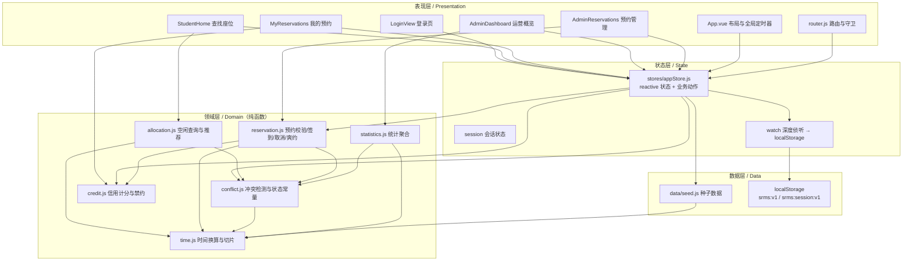
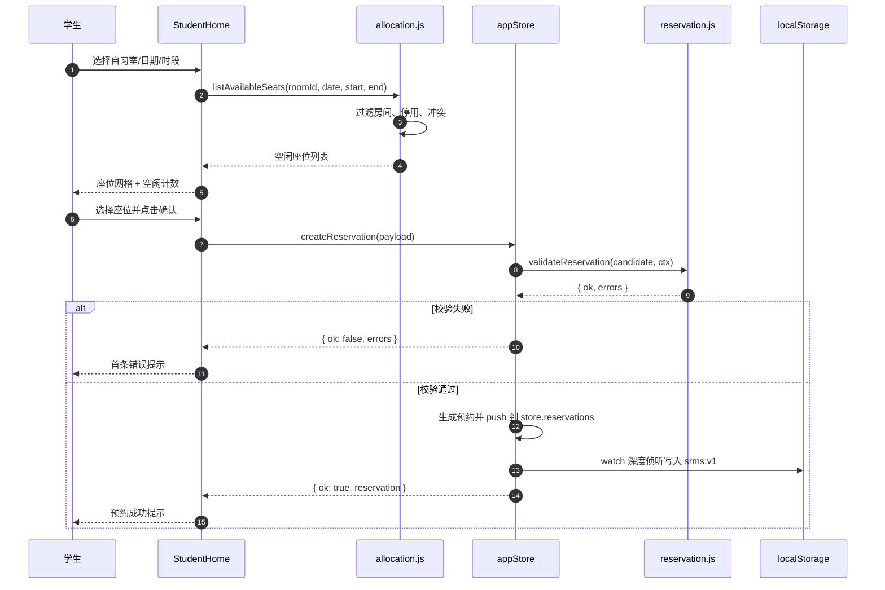
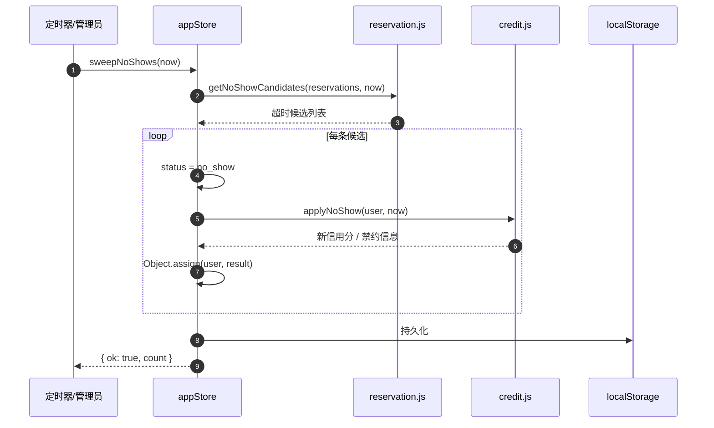
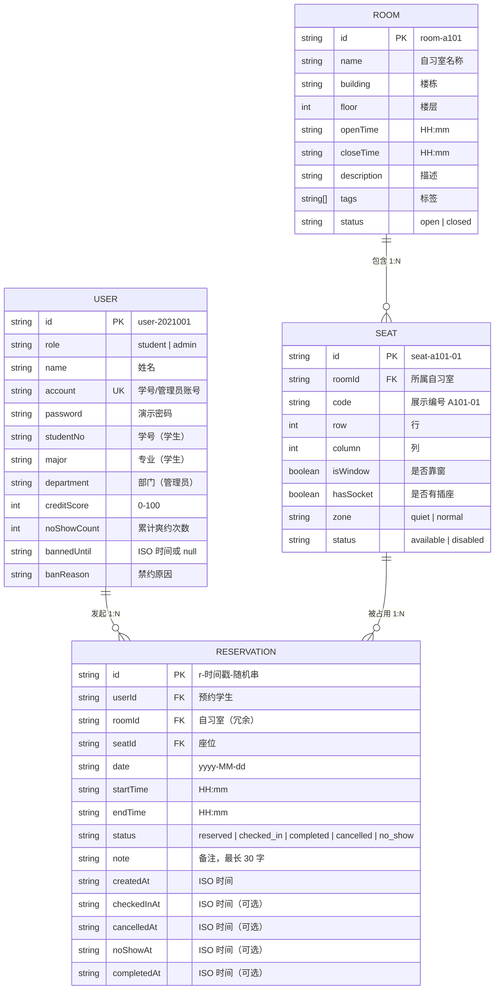
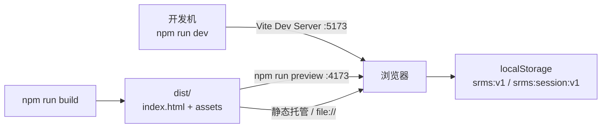

# 校园自习室预约系统 概要设计说明书

| 项目 | 内容 |
| --- | --- |
| 文档编号 | SRMS-HLD-02 |
| 版本 | v1.0 |
| 对应需求 | `docs/01-需求规格说明书.md` |
| 设计范围 | 总体架构、模块划分、数据模型、持久化、路由与部署 |

## 1. 设计目标与约束

### 1.1 目标

1. **纯前端可运行**：不依赖后端与数据库，双击预览即可演示完整业务闭环；
2. **业务逻辑可测试**：预约、冲突、计分等规则下沉为无副作用纯函数，单元测试可在 Node 环境直接执行；
3. **状态可持久化**：页面刷新、浏览器重启后数据不丢失；
4. **角色边界清晰**：学生与管理员的路由、页面、动作权限相互隔离；
5. **结构可扩展**：未来接入真实后端时，只需替换数据访问层，领域层与视图层保持不变。

### 1.2 约束

| 约束 | 影响 |
| --- | --- |
| 仅浏览器环境 | 无服务端并发锁，冲突检测基于本地快照 |
| localStorage 容量约 5MB | 单条预约约 200 字节，可容纳约 2 万条，满足演示规模 |
| 无第三方 UI 组件库 | 样式集中在 `src/styles.css`，组件需自行实现 |
| 时间为本地时区 | 日期键统一为 `yyyy-MM-dd`，时间统一为 `HH:mm` |

## 2. 分层架构

系统采用"视图层—状态层—领域层—数据层"四层结构。依赖方向严格自上而下：视图层只调用状态层与领域层的只读查询；状态层编排领域函数并写入响应式数据；领域层不感知 Vue 与浏览器 API，保证可测试性。



### 2.1 分层职责

| 层 | 目录 | 职责 | 禁止事项 |
| --- | --- | --- | --- |
| 表现层 | `src/views`、`src/App.vue`、`src/router.js` | 渲染、交互、表单校验反馈、路由守卫 | 不直接写 localStorage，不实现业务规则 |
| 状态层 | `src/stores` | 持有全局状态、编排领域函数、持久化、权限校验 | 不包含纯计算细节，不直接操作 DOM |
| 领域层 | `src/domain` | 时间、冲突、分配、计分、校验、统计 | 不引用 Vue，不读写浏览器 API，不使用当前时间默认值以外的隐式状态 |
| 数据层 | `src/data`、浏览器 | 种子数据、序列化与版本校验 | 不承载业务判断 |

## 3. 模块划分

| 模块 | 文件 | 主要导出 | 说明 |
| --- | --- | --- | --- |
| 时间模块 | `domain/time.js` | `timeToMinutes`、`minutesToTime`、`rangesOverlap`、`splitRange`、`isAlignedToSlot`、`isWithinRange`、`toDateKey`、`toDateTime`、`addDays` | 统一时间表示，提供 30 分钟切片与日期运算 |
| 冲突模块 | `domain/conflict.js` | `RESERVATION_STATUS`、`ACTIVE_STATUSES`、`isActiveReservation`、`findSeatConflicts`、`findUserConflicts`、`detectConflicts` | 定义状态机常量，判定座位冲突与用户冲突 |
| 分配模块 | `domain/allocation.js` | `seatPreferenceScore`、`listAvailableSeats`、`recommendSeats`、`pickBestSeat`、`countAvailableSeats`、`seatSlotUsage`、`dailyOccupancyRate`、`todayAvailabilitySummary` | 空闲座位查询、偏好推荐、容量与使用率 |
| 信用模块 | `domain/credit.js` | `CREDIT_RULES`、`clampScore`、`getCreditLevel`、`applyNoShow`、`applyCheckIn`、`isBanned`、`banRemainingDays`、`liftBan`、`canReserve` | 计分、禁约、等级与解除 |
| 预约模块 | `domain/reservation.js` | `BOOKING_RULES`、`validateReservation`、`canCheckIn`、`canCancel`、`isNoShow`、`getNoShowCandidates`、`settleReservation` | 预约全生命周期的规则判定 |
| 统计模块 | `domain/statistics.js` | `countByStatus`、`buildOverview`、`occupancyByRoom`、`hourlyHeatmap`、`roomSeatStatus` | 管理端指标聚合 |
| 种子模块 | `data/seed.js` | `createSeedData`、`STORAGE_KEY`、`SESSION_KEY`、`SEED_VERSION` | 生成演示数据，定义持久化键与版本 |
| 状态模块 | `stores/appStore.js` | `store`、`session`、`currentUser`、`login`、`createReservation`、`cancelReservation`、`checkInReservation`、`sweepNoShows`、`markNoShow`、`settleReservations`、`liftUserBan`、`toggleRoomStatus`、`resetDemoData` | 全局单例状态与业务动作 |
| 页面模块 | `views/*.vue` | 5 个页面组件 | 登录、学生端 2 页、管理端 2 页 |
| 路由模块 | `router.js` | `router` | Hash 路由与角色守卫 |

### 3.1 模块依赖关系

- `allocation` → `conflict`、`time`；
- `reservation` → `conflict`、`credit`、`time`；
- `statistics` → `conflict`、`time`；
- `conflict` → `time`；
- `appStore` → `reservation`、`credit`、`conflict`、`seed`；
- 视图 → `appStore` + 领域只读查询。

依赖无环，领域层内部仅存在单向依赖，便于单独测试与替换。

## 4. 运行时视图

### 4.1 预约主流程



### 4.2 爽约扫描流程



## 5. 数据模型

### 5.1 实体关系



### 5.2 字段设计说明

| 设计点 | 说明 |
| --- | --- |
| 时间用字符串而非 Date | 便于序列化、比较与展示；比较统一通过 `timeToMinutes` 转分钟数，避免时区与毫秒误差 |
| 日期键 `yyyy-MM-dd` | 可直接做字符串比较判断先后，避免 Date 对象的时区偏移 |
| 预约冗余 `roomId` | 避免每次渲染都要通过座位反查自习室，降低视图层复杂度；写入时由座位派生，保证一致 |
| 状态枚举集中定义 | `RESERVATION_STATUS` 与 `STATUS_META` 统一管理状态值与展示文案，避免拼写不一致 |
| 信用信息内嵌用户 | 演示规模下减少实体数量；生产环境可拆分为信用流水表 |

### 5.3 数据一致性约束

1. `Reservation.roomId` 必须等于 `Seat.roomId`；
2. `Reservation.seatId` 必须存在于 `Seat`；
3. `Reservation.userId` 必须存在且 `role = student`；
4. 任意两条活跃预约不得在同一座位同一时段重叠；
5. 同一学生的任意两条活跃预约不得在同一时段重叠；
6. `creditScore` 始终位于 `[0, 100]`；
7. 状态迁移必须符合状态机（见 `docs/03-详细设计.md` 第 6 节）。

前 5 条由 `validateReservation` 在写入前保证，第 6 条由 `clampScore` 保证，第 7 条由 store 动作保证。

## 6. 持久化设计

### 6.1 存储结构

```json
{
  "version": 1,
  "seedAt": "2026-11-03T08:00:00.000Z",
  "users": [],
  "rooms": [],
  "seats": [],
  "reservations": []
}
```

### 6.2 加载与写入

1. 模块加载时调用 `loadState()`：读取 `srms:v1`，`JSON.parse` 失败或版本不符或缺少 `users/seats` 数组时回退到 `createSeedData()`；
2. `store` 为 `reactive` 对象，`watch(store, persistState, { deep: true })` 监听任意层级变化并写入；
3. 会话单独存放于 `srms:session:v1`，只保存 `userId`，避免用户信息重复；
4. `resetDemoData()` 重新生成种子数据，`Object.assign(store, fresh)` 覆盖全部字段并清空会话。

### 6.3 版本策略

`SEED_VERSION` 与数据结构绑定。结构变更时递增版本号，旧数据因版本不匹配被自动丢弃并重建，避免迁移脚本复杂度。生产环境应改为增量迁移。

## 7. 路由与页面结构

| 路由 | 名称 | 组件 | 角色 | 说明 |
| --- | --- | --- | --- | --- |
| `#/login` | login | LoginView | 公开 | 已登录用户访问时按角色重定向 |
| `#/student` | student-home | StudentHome | student | 自习室、时段、座位选择与预约 |
| `#/student/reservations` | my-reservations | MyReservations | student | 信用卡、进行中预约、历史记录 |
| `#/admin` | admin-dashboard | AdminDashboard | admin | 指标、使用率、热度、风险管理、自习室开关 |
| `#/admin/reservations` | admin-reservations | AdminReservations | admin | 预约筛选、取消、标记爽约 |
| `#/` | - | 重定向 | - | 按登录角色跳转 |
| `#/:pathMatch(.*)*` | - | 重定向 | - | 未知路径回首页 |

采用 `createWebHashHistory`，使构建产物可直接以 `file://` 或任意静态路径访问，无需服务器重写规则。

## 8. 关键设计决策

| 决策 | 方案 | 理由 | 代价 |
| --- | --- | --- | --- |
| 状态管理 | 单例 `reactive` + `computed` | 规模小，无需 Pinia；减少依赖 | 多实例测试需隔离模块 |
| 业务逻辑位置 | 下沉到 `src/domain` 纯函数 | 可单测、可复用、可替换后端 | 视图层需要多写一层调用 |
| 时间段表示 | 字符串 + 分钟数换算 | 序列化友好，比较简单 | 需统一校验格式 |
| 冲突语义 | 左闭右开 `[start, end)` | 相邻预约不算冲突，符合直觉 | 需在文档与测试中明确 |
| 推荐算法 | 加权打分 + 编号排序 | 规则透明、可解释、易测试 | 未考虑实时人流等动态因素 |
| 持久化 | 整体 JSON 覆盖写 | 实现简单、原子性足够 | 数据量大时写放大 |
| 定时扫描 | 应用内 `setInterval` + 手动触发 | 无后端也能自动判爽约 | 页面关闭期间不执行 |

## 9. 部署视图



构建产物为纯静态文件，`base: './'` 保证相对路径可用。生产构建体积：JS 146.06 KB（gzip 53.68 KB），CSS 21.61 KB（gzip 4.83 KB），无外部 CDN 依赖。

## 10. 风险与后续演进

| 风险 | 影响 | 缓解 |
| --- | --- | --- |
| 多标签页并发写覆盖 | 数据丢失 | 监听 `storage` 事件或引入版本号冲突检测 |
| localStorage 被清理 | 数据重置 | 提供导出/导入 JSON |
| 前端明文密码 | 安全风险 | 演示限定；生产改为后端认证 + 令牌 |
| 无服务端锁 | 超卖（同一座位被两人同时预约） | 生产环境由数据库唯一约束/事务保证 |
| 统计口径单一 | 决策参考有限 | 增加周/月维度与导出报表 |