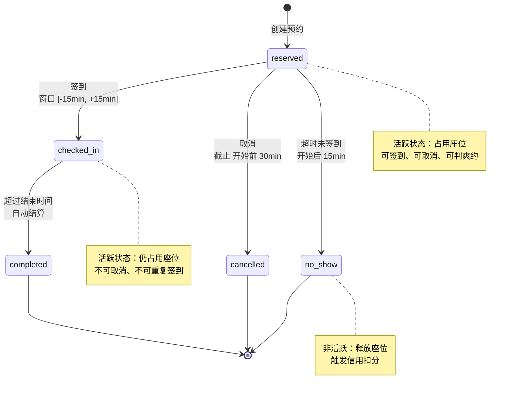
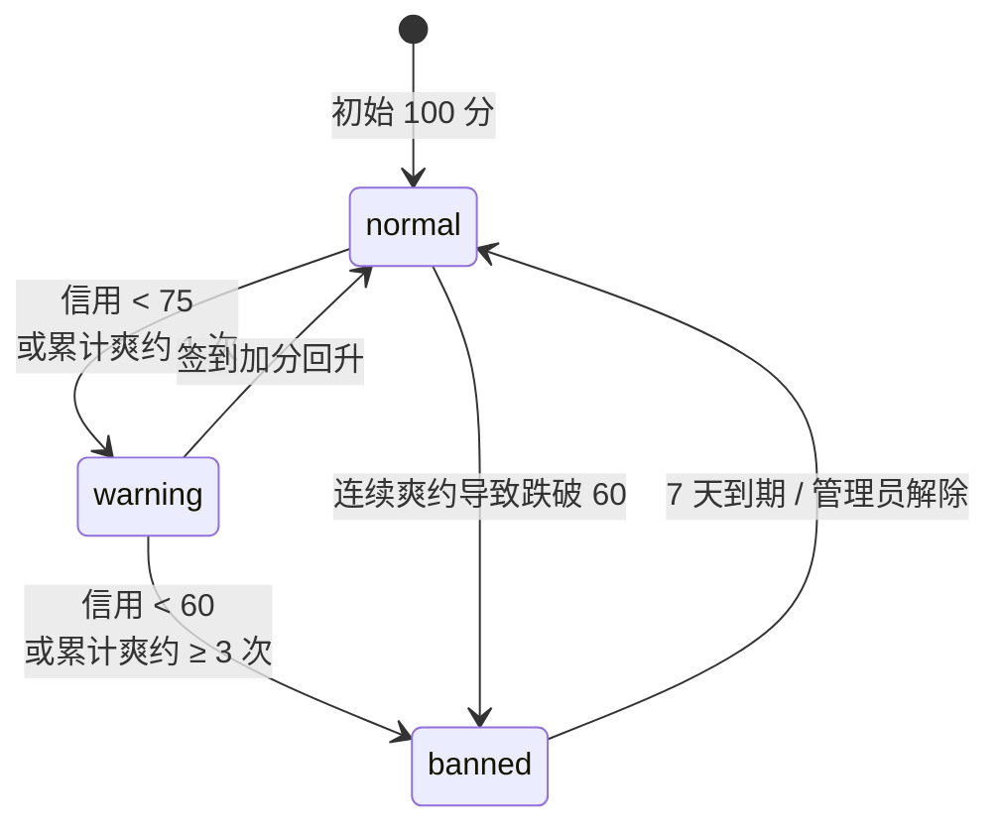
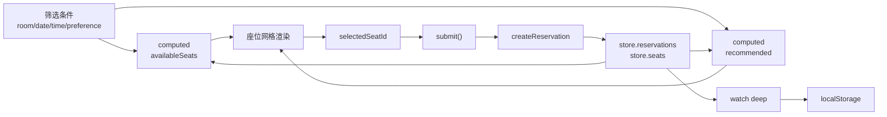

# 校园自习室预约系统 详细设计说明书

| 项目 | 内容 |
| --- | --- |
| 文档编号 | SRMS-LLD-03 |
| 版本 | v1.0 |
| 上游文档 | `docs/01-需求规格说明书.md`、`docs/02-概要设计.md` |
| 对应代码 | `src/domain/*.js`、`src/stores/appStore.js`、`src/views/*.vue` |

## 1. 时间模型

### 1.1 表示约定

| 概念 | 类型 | 格式 | 示例 |
| --- | --- | --- | --- |
| 日期键 | string | `yyyy-MM-dd` | `2026-11-04` |
| 时刻 | string | `HH:mm`（24 小时制，两位补零） | `09:30` |
| 当日分钟数 | number | `0-1439` | `570` |
| 时段 | object | `{ start, end, label }` | `{ start: '09:00', end: '09:30', label: '09:00-09:30' }` |
| 时间戳 | string | ISO 8601 | `2026-11-03T01:00:00.000Z` |

### 1.2 换算函数

```text
FUNCTION timeToMinutes(time):
    IF time is not string OR time does not match "^\d{2}:\d{2}$":
        RETURN NaN
    hour, minute = split(time, ":")
    IF hour > 23 OR minute > 59:
        RETURN NaN
    RETURN hour * 60 + minute

FUNCTION minutesToTime(minutes):
    IF minutes is not finite OR minutes < 0:
        RETURN ""
    safe = min(round(minutes), 1439)      // 23:59 封顶
    RETURN pad(hour(safe)) + ":" + pad(minute(safe))
```

所有时间比较均先转分钟数，避免字符串比较在跨小时时失效；非法输入统一返回 `NaN` 或空串，由上层转为"校验失败"而非抛异常，保证视图层不会因脏数据崩溃。

### 1.3 时间段切分算法

```text
FUNCTION splitRange(start, end, step = 30):
    startMinutes = timeToMinutes(start)
    endMinutes   = timeToMinutes(end)
    IF start or end is NaN: RETURN []
    IF step <= 0 OR startMinutes >= endMinutes: RETURN []

    slots = []
    cursor = startMinutes
    WHILE cursor + step <= endMinutes:
        slots.push({
            start: minutesToTime(cursor),
            end:   minutesToTime(cursor + step),
            label: start + "-" + end
        })
        cursor = cursor + step
    RETURN slots
```

**复杂度**：O((end−start)/step)，单次最多 28 个切片（08:00-22:00）。

**边界处理**：

| 输入 | 输出 | 原因 |
| --- | --- | --- |
| `09:00, 09:45` | 1 个切片 | 尾部 15 分钟不足一步长，丢弃 |
| `09:00, 09:29` | 空数组 | 不足最小粒度 |
| `09:00, 09:30, 15` | 2 个切片 | 支持自定义步长 |
| `10:00, 09:00` | 空数组 | 反向区间 |
| `bad, 10:00` | 空数组 | 非法输入 |

## 2. 冲突检测算法

### 2.1 区间重叠判定

采用左闭右开语义：`[aStart, aEnd)` 与 `[bStart, bEnd)` 重叠的充要条件是 `aStart < bEnd 且 bStart < aEnd`。

```text
FUNCTION rangesOverlap(aStart, aEnd, bStart, bEnd):
    as, ae, bs, be = toMinutes(each)      // 已是数字则直接使用
    IF any is NaN: RETURN false
    RETURN as < be AND bs < ae
```

| 用例 | 结果 | 说明 |
| --- | --- | --- |
| 09:00-11:00 vs 10:00-12:00 | true | 常规重叠 |
| 09:00-10:00 vs 10:00-11:00 | false | 首尾相接不算重叠 |
| 09:00-11:00 vs 09:30-10:30 | true | 包含关系 |
| 09:00-11:00 vs 11:00-12:00 | false | 右边界相接 |

### 2.2 冲突检测流程

```text
FUNCTION isActiveReservation(r):
    RETURN r != null AND r.status IN {reserved, checked_in}

FUNCTION findSeatConflicts(candidate, reservations):
    RETURN reservations.filter(item =>
        item.id != candidate.id                 // 编辑场景排除自身
        AND item.seatId == candidate.seatId
        AND item.date   == candidate.date
        AND isActiveReservation(item)
        AND rangesOverlap(candidate.startTime, candidate.endTime,
                          item.startTime, item.endTime))

FUNCTION findUserConflicts(candidate, reservations):
    RETURN reservations.filter(item =>
        item.id != candidate.id
        AND item.userId == candidate.userId
        AND item.date   == candidate.date
        AND isActiveReservation(item)
        AND rangesOverlap(...))

FUNCTION detectConflicts(candidate, reservations, options = {}):
    result = []
    IF options.checkSeat != false:
        FOR item IN findSeatConflicts(...): result.push({ type: "seat", reservation: item })
    IF options.checkUser != false:
        FOR item IN findUserConflicts(...): result.push({ type: "user", reservation: item })
    RETURN result
```

**复杂度**：O(n)，n 为预约总数；单次预约校验最多两次线性扫描。60 座位、5000 条预约时约 1 万次比较，实测远低于 50ms。

**为什么仅活跃状态参与**：已取消、已爽约、已完成的记录不再占用座位，也不应阻止用户重新预约。该规则由 `ACTIVE_STATUSES` 常量集中维护，避免各处硬编码。

**为什么区分 seat/user**：两类冲突的提示语与处理策略不同。座位冲突说明资源被占，需换座；用户冲突说明本人时间撞车，需改时段。

## 3. 座位分配算法

### 3.1 偏好打分

```text
FUNCTION seatPreferenceScore(seat, preference = {}):
    score = 0
    IF preference.socket AND seat.hasSocket: score += 3
    IF preference.window AND seat.isWindow: score += 2
    IF preference.quiet  AND seat.zone == "quiet": score += 1
    RETURN score
```

权重体现"插座 > 靠窗 > 安静"的优先级；权重集中为字面量，便于后续配置化。

### 3.2 空闲座位查询

```text
FUNCTION listAvailableSeats({ roomId, date, startTime, endTime, seats, reservations, excludeId }):
    base = { id: excludeId, date, startTime, endTime }
    RETURN seats
        .filter(seat => seat.roomId == roomId)
        .filter(seat => seat.status != "disabled")
        .filter(seat => findSeatConflicts({...base, seatId: seat.id}, reservations).isEmpty())
```

**复杂度**：O(m × n)，m 为候选座位数（每室 12），n 为预约数。后续可优化为"按座位建索引 + 时段桶"，但当前规模无需。

### 3.3 推荐排序

```text
FUNCTION recommendSeats({ preference, limit = 3, ...params }):
    available = listAvailableSeats(params)
    sorted = sort available BY:
        score(desc)                                  // 偏好得分高者优先
        THEN code(asc)                               // 同分按座位编号稳定排序
    RETURN sorted[0 .. min(limit, len)]

FUNCTION pickBestSeat(params):
    RETURN recommendSeats({...params, limit: 1})[0] OR null
```

**稳定性**：`Array.prototype.sort` 在比较函数返回 0 时保持相对顺序，但不同引擎不保证；因此显式加入 `code` 作为第二排序键，保证结果可复现、可断言。

### 3.4 容量与使用率

```text
FUNCTION countAvailableSeats({ room, date, startTime, endTime, seats, reservations }):
    roomSeats = seats.filter(s => s.roomId == room.id AND s.status != "disabled")
    available = listAvailableSeats({ roomId: room.id, ... })
    RETURN { total: len(roomSeats), available: len(available), occupied: total - available }

FUNCTION seatSlotUsage({ room, date, startTime, endTime, seats, reservations }):
    slots = splitRange(startTime, endTime)
    IF slots.isEmpty() OR roomSeats.isEmpty(): RETURN { totalSlots: 0, usedSlots: 0, rate: 0 }
    usedSlots = 0
    FOR seat IN roomSeats:
        FOR slot IN slots:
            IF findSeatConflicts({ seatId: seat.id, date, slot.start, slot.end }, reservations).notEmpty():
                usedSlots += 1
    totalSlots = len(roomSeats) × len(slots)
    RETURN { totalSlots, usedSlots, rate: round(usedSlots / totalSlots × 100) }
```

## 4. 预约校验算法

```text
FUNCTION validateReservation(candidate, context):
    errors = []
    { seat, room, user, reservations = [], now = new Date(), rules = BOOKING_RULES } = context
    today = toDateKey(now)

    // 1. 必填项
    IF candidate is null OR candidate.seatId is empty: errors.push("请选择座位")
    IF candidate.date is empty:                         errors.push("请选择预约日期")
    IF candidate.startTime or candidate.endTime empty:  errors.push("请选择预约时段")

    // 2. 日期合法性
    IF candidate.date:
        IF parseDateKey(candidate.date) is null:        errors.push("预约日期格式不正确")
        ELSE IF candidate.date < today:                 errors.push("不能预约过去的日期")
        ELSE IF candidate.date > addDays(today, 6):     errors.push("最多可提前 7 天预约")

    // 3. 时段合法性
    IF start AND end:
        IF NOT aligned(start) OR NOT aligned(end):      errors.push("预约时间必须按 30 分钟对齐")
        IF duration <= 0:                               errors.push("结束时间必须晚于开始时间")
        ELSE:
            IF duration < 30:                           errors.push("单次预约不得少于 30 分钟")
            IF duration > 240:                          errors.push("单次预约不得超过 240 分钟")
        IF room AND NOT within(start, end, room.open, room.close):
                                                        errors.push("预约时段须在开放时间 ... 内")
        IF candidate.date == today AND toMinutes(start) < now.minutesOfDay:
                                                        errors.push("不能预约已经开始的时段")

    // 4. 资源状态
    IF seat AND room AND seat.roomId != room.id:        errors.push("座位不属于所选自习室")
    IF seat AND seat.status == "disabled":              errors.push("该座位已停用")
    IF user AND NOT canReserve(user, now):              errors.push("你当前处于爽约禁约期，暂不能预约")

    // 5. 冲突
    IF seat AND start AND end:
        conflicts = detectConflicts({ ...candidate, seatId: seat.id }, reservations)
        IF conflicts has type "seat":                    errors.push("该座位在所选时段已被预约")
        IF conflicts has type "user":                    errors.push("你在所选时段已有其他预约")

    RETURN { ok: len(errors) == 0, errors }
```

**设计要点**：

1. **错误累积而非短路**：一次性返回全部错误，前端取首条展示，测试可断言完整错误集合；
2. **依赖注入 `now`**：默认值为 `new Date()`，测试显式传入固定时间，无需 mock 全局时钟；
3. **按块校验**：字段缺失时跳过依赖该字段的后续校验，避免产生"级联噪声错误"；
4. **时长与对齐解耦**：`09:10` 同时触发"未对齐"与"时长合法"，两者独立判断，提示更完整。

## 5. 爽约计分算法

### 5.1 规则常量

| 常量 | 值 | 含义 |
| --- | --- | --- |
| `initialScore` | 100 | 初始信用分 |
| `minScore` / `maxScore` | 0 / 100 | 分值上下限 |
| `noShowDelta` | -10 | 每次爽约扣分 |
| `checkInDelta` | +2 | 每次签到加分 |
| `banScore` | 60 | 低于该值触发禁约 |
| `banNoShowCount` | 3 | 累计爽约达到该次数触发禁约 |
| `banDays` | 7 | 禁约天数 |

### 5.2 计分伪代码

```text
FUNCTION clampScore(score, rules):
    IF score is not finite: RETURN rules.initialScore
    RETURN min(rules.maxScore, max(rules.minScore, score))

FUNCTION applyNoShow(user, now = new Date(), rules):
    baseScore = user.creditScore if finite else rules.initialScore
    score = clampScore(baseScore + rules.noShowDelta)
    noShowCount = (user.noShowCount or 0) + 1
    shouldBan = score < rules.banScore OR noShowCount >= rules.banNoShowCount

    existingBan = parse(user.bannedUntil) if present
    shouldExtend = shouldBan AND (existingBan is null OR existingBan <= now)
    bannedUntil = now + rules.banDays days if shouldExtend
                  else user.bannedUntil or null

    RETURN {
        creditScore: score,
        noShowCount,
        bannedUntil,
        banReason: bannedUntil ? "爽约 N 次，信用分 S" : null,
        updatedAt: now.toISOString()
    }
```

**幂等性讨论**：同一预约重复调用 `applyNoShow` 会重复扣分。因此 `sweepNoShows` 在调用前先校验状态并置为 `no_show`，状态迁移后不会再被 `getNoShowCandidates` 选中，从流程上避免重复计分。

### 5.3 禁约判定

```text
FUNCTION isBanned(user, now):
    IF user is null OR user.bannedUntil is null: RETURN false
    until = parse(user.bannedUntil)
    IF until is invalid: RETURN false
    RETURN until > now

FUNCTION banRemainingDays(user, now):
    IF NOT isBanned(user, now): RETURN 0
    RETURN ceil((bannedUntil - now) / 1 day)

FUNCTION liftBan(user):
    RETURN { ...user, bannedUntil: null, banReason: null }
```

**重复触发策略**：`shouldExtend` 只在"无禁约"或"旧禁约已过期"时为真。若用户处于禁约期再次爽约，仅扣分与累加次数，不把期限从 7 天继续后推，避免惩罚无限叠加。

## 6. 状态机

### 6.1 预约状态机



### 6.2 状态迁移表

| 当前状态 | 事件 | 条件 | 目标状态 | 副作用 |
| --- | --- | --- | --- | --- |
| 无 | 创建预约 | 校验全部通过 | `reserved` | 写入记录，占用座位 |
| `reserved` | 签到 | 当日且处于签到窗口 | `checked_in` | 写入 `checkedInAt`，信用 +2 |
| `reserved` | 取消 | 开始前 ≥ 30 分钟（管理员不受限） | `cancelled` | 写入 `cancelledAt`，释放座位 |
| `reserved` | 爽约扫描 | 当前时间 > 开始 + 15 分钟 | `no_show` | 写入 `noShowAt`，信用 -10，可能禁约 |
| `checked_in` | 自动结算 | 当前时间 > 结束时间 | `completed` | 写入 `completedAt` |
| `cancelled` / `no_show` / `completed` | 任意 | - | 不变 | 非法迁移被拒绝 |

### 6.3 信用状态机



## 7. 关键接口约定

### 7.1 领域层函数

| 函数 | 入参 | 返回 | 边界与约定 |
| --- | --- | --- | --- |
| `timeToMinutes(time)` | `string` | `number` 或 `NaN` | 仅接受 `HH:mm` |
| `minutesToTime(minutes)` | `number` | `string`，非法为空串 | 超过 23:59 封顶 |
| `rangesOverlap(aS, aE, bS, bE)` | 时间串或分钟数 | `boolean` | 非法输入返回 `false` |
| `isAlignedToSlot(time, step=30)` | `string` | `boolean` | 非法返回 `false` |
| `isWithinRange(s, e, rs, re)` | 4 个时间串 | `boolean` | 要求 `s < e` |
| `splitRange(start, end, step=30)` | 时间串 | `Slot[]` | 反向、非法、步长 ≤ 0 返回 `[]` |
| `toDateKey(date)` | `Date` | `yyyy-MM-dd` | 本地时区 |
| `parseDateKey(key)` | `string` | `Date` 或 `null` | 拒绝 `2026-02-30` |
| `toDateTime(dateKey, time)` | `string, string` | `Date` 或 `null` | 本地时区 |
| `findSeatConflicts(candidate, list)` | 候选预约、预约数组 | `Reservation[]` | 只匹配活跃状态，排除自身 `id` |
| `findUserConflicts(candidate, list)` | 同上 | `Reservation[]` | 同上 |
| `detectConflicts(candidate, list, options)` | 候选、预约、开关 | `{type, reservation}[]` | `checkSeat/checkUser` 默认 true |
| `listAvailableSeats(params)` | 见 3.2 | `Seat[]` | 过滤停用与冲突，不校验房间关闭 |
| `recommendSeats(params)` | 含 `preference`、`limit` | `Seat[]` | 稳定排序，`limit` 默认 3 |
| `countAvailableSeats(params)` | 含 `room` | `{total, available, occupied}` | `available` 不含停用座位 |
| `seatSlotUsage(params)` | 含 `room` | `{totalSlots, usedSlots, rate}` | 空集合返回全 0 |
| `validateReservation(candidate, ctx)` | 候选、上下文 | `{ok, errors[]}` | 不抛异常，错误累积 |
| `canCheckIn(reservation, now, rules)` | 预约、当前时间 | `boolean` | 状态必须为 `reserved` |
| `canCancel(reservation, now, rules)` | 同上 | `boolean` | 边界含 30 分钟整 |
| `isNoShow(reservation, now, rules)` | 同上 | `boolean` | 严格大于开始 + 15 分钟 |
| `getNoShowCandidates(list, now, rules)` | 预约数组 | `Reservation[]` | 仅 `reserved` |
| `settleReservation(reservation, now)` | 预约、当前时间 | `Reservation` | 未到期原样返回 |
| `applyNoShow(user, now, rules)` | 用户、当前时间 | 信用补丁对象 | 幂等性由调用方保证 |
| `applyCheckIn(user, rules)` | 用户 | `{creditScore, updatedAt}` | 上限 100 |
| `isBanned(user, now)` | 用户、当前时间 | `boolean` | 非法时间返回 `false` |
| `banRemainingDays(user, now)` | 同上 | `number` | 向上取整，未禁约为 0 |
| `buildOverview(reservations, users, now)` | 数组、时间 | 统计对象 | 分母为 0 时比率返回 0 |
| `occupancyByRoom({rooms, seats, reservations, date})` | 上下文 | `RoomStat[]` | 跳过关闭房间，使用率封顶 100 |
| `hourlyHeatmap(reservations, date)` | 预约、日期 | `{hour, count}[]` | 固定 08:00-21:00，共 14 项 |

### 7.2 状态层动作

| 动作 | 入参 | 返回 | 权限与失败语义 |
| --- | --- | --- | --- |
| `login(account, password, role)` | 账号、密码、角色 | `{ok, user}` 或 `{ok:false, message}` | 账号与角色不匹配优先于密码错误 |
| `logout()` | - | 无 | 清空会话 |
| `createReservation(payload, now)` | 座位、日期、时段、备注 | `{ok, reservation}` / `{ok:false, errors}` | 未登录、非学生、座位不存在均拒绝 |
| `cancelReservation(id, now)` | 预约 ID | `{ok, message}` | 学生仅本人，管理员任意 |
| `checkInReservation(id, now)` | 预约 ID | `{ok, message}` | 仅本人，窗口外拒绝 |
| `sweepNoShows(now)` | 当前时间 | `{ok, count}` | 批量判定，返回处理条数 |
| `markNoShow(id, now)` | 预约 ID | `{ok, message}` | 仅管理员入口调用 |
| `settleReservations(now)` | 当前时间 | `count` | 批量结算已签到记录 |
| `liftUserBan(userId)` | 用户 ID | `{ok, message}` | 用户不存在返回失败 |
| `toggleRoomStatus(roomId)` | 自习室 ID | `{ok, message}` | 切换 `open/closed` |
| `resetDemoData()` | - | `{ok}` | 覆盖全部数据并清空会话 |

### 7.3 前端组件契约

| 组件 | Props | Emits | 说明 |
| --- | --- | --- | --- |
| `LoginView` | 无 | 无 | 内部维护 `role/form/error/submitting` |
| `StudentHome` | 无 | 无 | 维护 `selectedRoomId/selectedDate/startTime/endTime/selectedSeatId/preference/note`，通过 `computed` 派生空闲列表与推荐 |
| `MyReservations` | 无 | 无 | 维护 `now`，每 30 秒刷新以驱动签到/取消按钮可用性 |
| `AdminDashboard` | 无 | 无 | 维护 `activeDate`，派生概览、使用率、热度、风险列表 |
| `AdminReservations` | 无 | 无 | 维护筛选条件 `{status, date, keyword}` |

## 8. 视图层数据流



**关键点**：视图不缓存业务状态，只缓存用户输入；所有派生数据通过 `computed` 实时重算。这样预约成功、爽约扫描、管理员干预后，界面无需手动刷新即可保持一致。

## 9. 错误文案与提示规范

| 场景 | 文案 | 级别 |
| --- | --- | --- |
| 账号/角色不匹配 | 账号不存在，或角色选择有误 | danger |
| 密码错误 | 密码不正确 | danger |
| 未选座位 | 请先在座位图中选择一个空闲座位 | warning |
| 座位冲突 | 该座位在所选时段已被预约 | danger |
| 用户冲突 | 你在所选时段已有其他预约 | danger |
| 禁约 | 你当前处于爽约禁约期，暂不能预约 | danger |
| 签到窗口外 | 签到窗口为开始前 15 分钟至开始后 15 分钟 | danger |
| 取消超时 | 仅可在开始前 30 分钟取消待签到预约 | danger |
| 无可用座位 | 该时段已没有可预约座位 | warning |
| 操作成功 | 预约成功 / 签到成功，信用分 +2 | success |

提示条 3.5-4 秒后自动消失，由各页面 `setTimeout` 控制；危险操作（取消、标记爽约、重置）使用 `window.confirm` 二次确认。

## 10. 性能分析与优化点

| 操作 | 复杂度 | 实测/估算 |
| --- | --- | --- |
| 空闲座位查询 | O(m × n)，m=12，n=5000 | 约 6 万次比较，< 10ms |
| 推荐排序 | O(m log m + m × n) | m ≤ 12，可忽略 |
| 冲突检测（单次） | O(n) | 5000 条约 1ms |
| 时段切片 | O(时长/30) | 最多 28 次循环 |
| 深度侦听持久化 | O(数据量) 序列化 | 5000 条约 1MB，写入约 10-20ms |

**可优化项**：

1. 为每个座位维护"按日期的预约索引"，将查询降为 O(k)；
2. `seatSlotUsage` 内层重复调用 `splitRange`，可提前计算一次并复用；
3. 持久化改为防抖（例如 200ms）以减少连续写入；
4. 大数据量下使用 `structuredClone` 或增量补丁替代整体序列化。

以上优化不影响当前演示规模，故未在 v1.0 实施。

## 11. 安全与异常处理

1. **越权防护**：`cancelReservation` 校验 `reservation.userId === user.id || user.role === 'admin'`；`checkInReservation` 仅允许本人；
2. **脏数据防护**：`safeParse` 捕获 JSON 解析异常，`loadState` 校验版本与必要数组，异常时回退种子数据；
3. **时间异常**：所有日期解析失败返回 `null`，避免 `Invalid Date` 传播；
4. **数值边界**：信用分通过 `clampScore` 限制在 0-100；统计比率在分母为 0 时返回 0；
5. **展示安全**：Vue 模板默认转义，用户备注不会作为 HTML 注入；
6. **已知局限**：密码明文、无服务端鉴权、无防篡改，仅适用于教学演示。