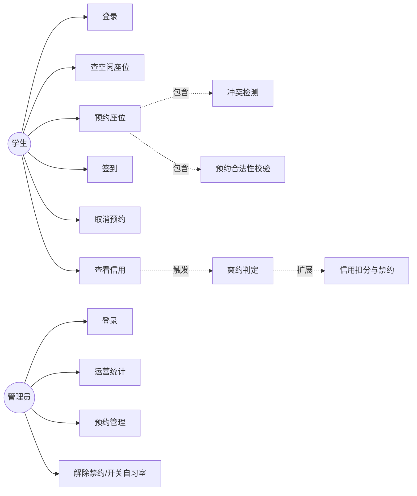
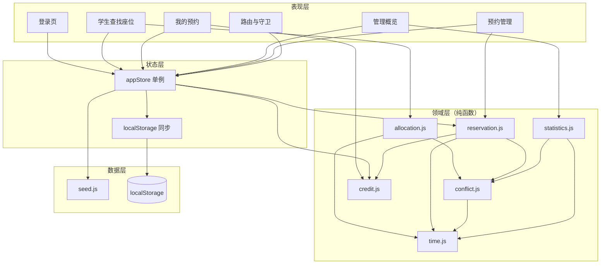
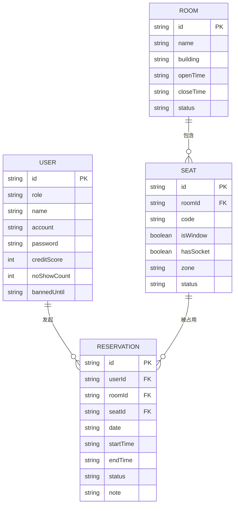
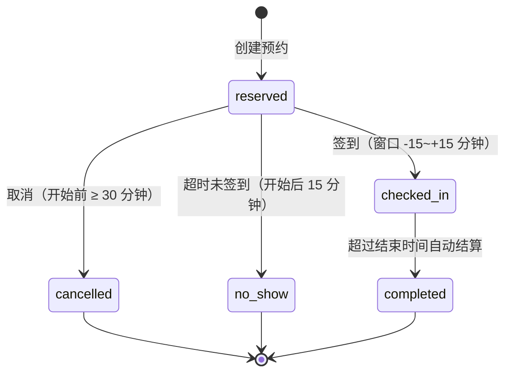
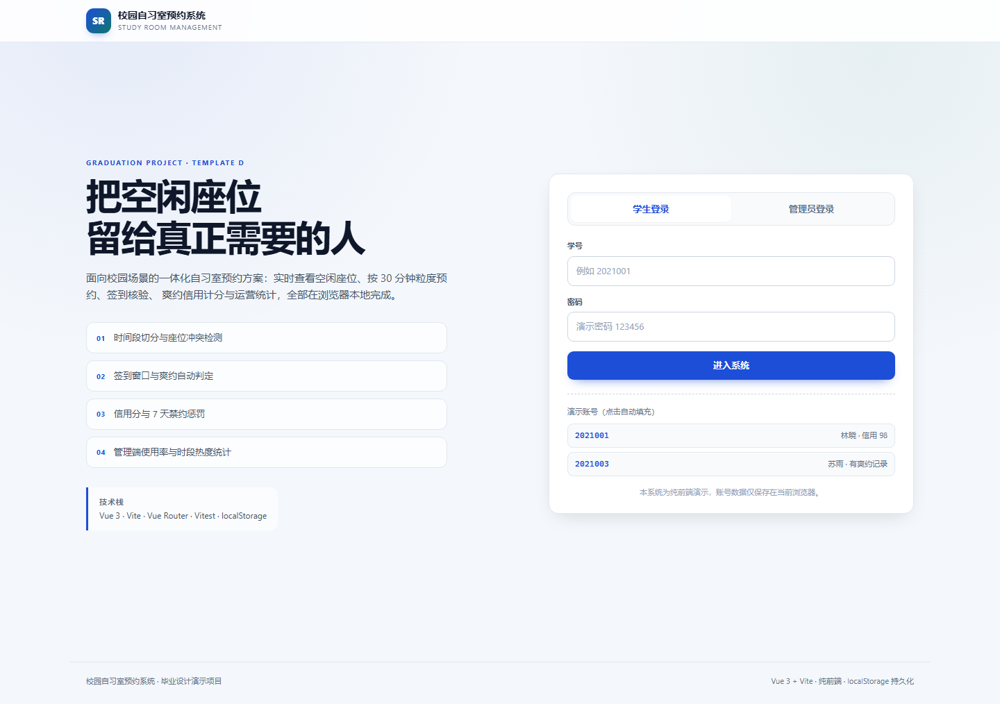
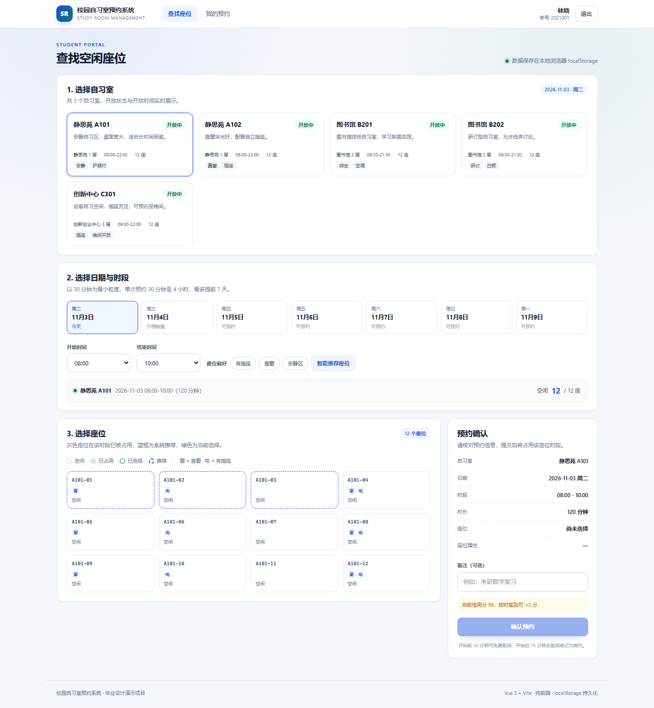
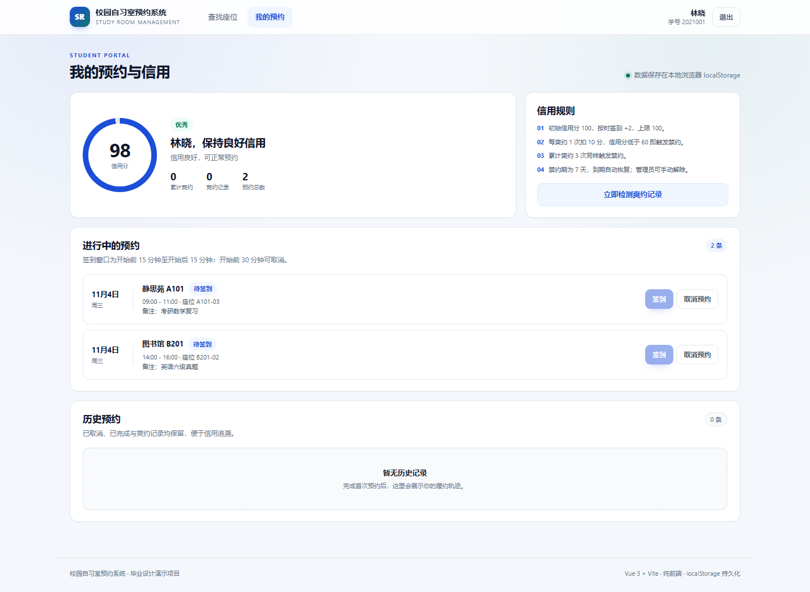
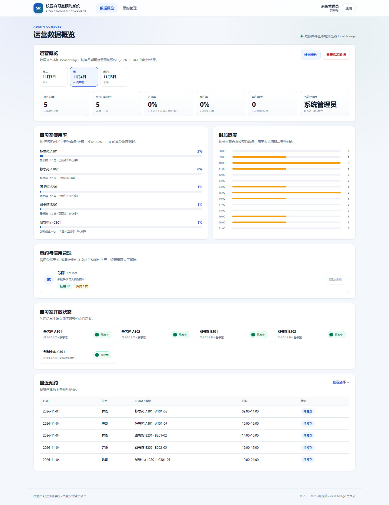
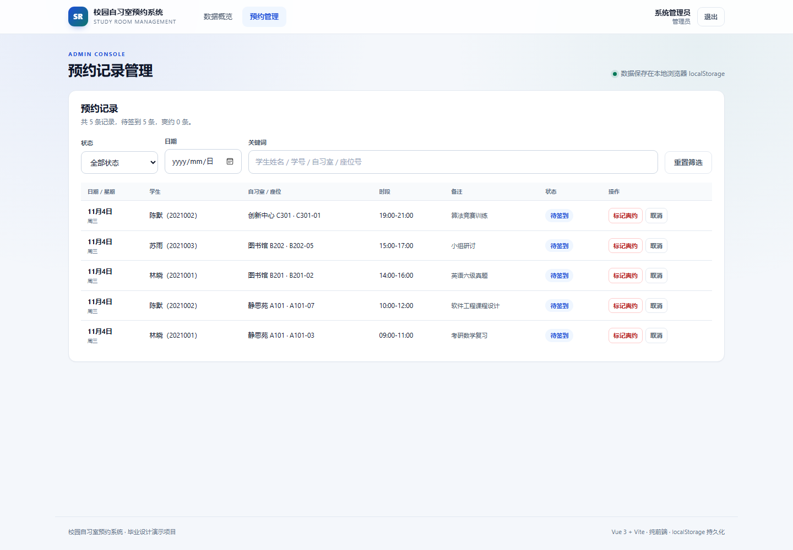

# 基于 Vue 3 的校园自习室预约系统设计与实现

**摘要**：针对高校自习室"找座难、占座多、爽约无成本、管理缺数据"的问题，本文设计并实现了一套纯前端的校园自习室预约系统。系统采用 Vue 3 + Vite 构建，以浏览器 localStorage 作为持久化介质，不依赖后端服务即可完成"查空闲座位—预约—签到—取消—爽约判定—信用惩罚—运营统计"的完整闭环。设计上将业务规则下沉为 6 个无副作用的领域模块，通过参数注入消除时间不确定性，使核心逻辑可在 Node 环境中直接进行单元测试。系统实现了以 30 分钟为粒度的时段切分、基于左闭右开区间的座位冲突与用户冲突检测、按"插座 3 分 / 靠窗 2 分 / 安静区 1 分"加权的座位推荐、以及"爽约扣 10 分、信用低于 60 分或累计爽约 3 次禁约 7 天"的信用模型。测试共编写 97 条单元用例，全部通过，领域层行覆盖率 99.30%、分支覆盖率 97.90%。生产构建产物为 146.06 KB JavaScript（gzip 53.68 KB）与 21.61 KB CSS，可部署于任意静态服务器。结果表明，该方案能够以较低复杂度满足课程设计与中小规模场景的预约需求，并为后续接入真实后端保留了清晰的替换边界。

**关键词**：校园自习室；预约系统；Vue 3；冲突检测；信用计分；单元测试

## 第 1 章 绪论

### 1.1 研究背景

自习室是高校学生最主要的自主学习空间之一。随着考研、考公、竞赛与课程设计等学习需求的增长，图书馆与教学楼自习室的座位在考试季、期末周长期处于紧张状态。实际使用中普遍存在三类矛盾。

第一，**信息不透明造成的无效往返**。学生往往只能到现场寻找座位，若目标自习室满座，需要转场，时间成本高；不同楼栋、不同楼层的开放时间与座位类型也不一致，缺少统一入口。

第二，**占座与爽约造成的资源闲置**。部分学生提前占座后长时间不到场，或预约后不履约，导致"显示有座、实际无人"的悖论。人工巡查成本高、取证困难，且缺少可执行的约束手段。

第三，**管理决策缺少数据支撑**。自习室管理者通常只知道"人多/人少"，难以回答"哪个时段最紧张""哪个自习室使用率最低""哪些学生频繁爽约"等问题，因而无法据此调整开放时段、值班安排或座位布局。

本文以毕业设计为契机，设计一套面向校园场景的预约系统，目标是在不引入后端与数据库的前提下，把上述三类问题收敛为一个可演示、可测试、可度量的软件闭环。选择纯前端方案并非否定后端价值，而是希望在有限周期内把**业务规则的正确性**做扎实，并为后续工程化留下接口边界。

### 1.2 现有方案与不足

目前高校中常见的座位管理方式包括三类。

**（1）人工登记与现场管理。** 由管理员在门口登记或发放号牌。优点是零开发成本，缺点是高峰期排队、无法提前查询、记录不可追溯。

**（2）商业或平台化的座位预约系统。** 许多高校图书馆引入了座位预约模块，通常具备扫码签到、违规记录等功能。这类系统依赖服务端、数据库、门禁或二维码硬件，部署与运维成本较高，且规则往往由厂商固化，难以按院系需求调整。

**（3）基于即时通讯工具的约定式管理。** 通过班级群、小程序接龙等方式登记。灵活性高，但数据分散、冲突靠人工判断、缺少信用约束，难以形成稳定制度。

从功能上看，上述方案大多覆盖了"预约"这一动作，但在三个细节上仍有改进空间：

1. **冲突判定语义不严谨**。部分系统按整点或整小时切分，相邻时段被误判为冲突，或反之出现边界重叠；
2. **爽约惩罚缺少可解释的量化模型**。常见做法是"违规 N 次封禁"，但没有区分扣分与禁约两条触发路径，也没有处理"禁约期内再次违规是否叠加"的问题；
3. **统计口径不稳定**。使用率的分母（开放时长 × 座位数）与分子（有效预约时长）若未明确定义，容易出现超过 100% 或把取消记录计入占用的错误。

本文将上述细节作为设计重点，并在实现后用单元测试逐条固化。

### 1.3 研究内容

本文的主要工作包括：

1. **需求与规则建模**：定义学生/管理员两类角色，梳理 8 条核心用例，把预约、签到、取消、爽约、禁约、统计等规则写成可执行的边界条件；
2. **分层架构设计**：将系统划分为表现层、状态层、领域层与数据层，领域层保持纯函数，避免业务逻辑与 Vue 响应式耦合；
3. **核心算法实现**：实现 30 分钟时段切分、左闭右开区间冲突检测、加权座位推荐、信用计分与禁约判定；
4. **纯前端持久化**：基于 localStorage 实现带版本号的整体持久化，异常数据自动回退种子数据；
5. **测试与验证**：使用 Vitest 编写 97 条单元用例，配置 80% 覆盖率门禁，并通过无头浏览器完成 5 个页面的截图验收。

### 1.4 论文结构

第 1 章介绍背景、现有方案与本文工作；第 2 章说明 Vue 3、Vite、localStorage、Vitest 等技术选型理由；第 3 章进行角色、功能、用例与非功能需求分析；第 4 章给出分层架构、数据模型、核心算法与状态机设计；第 5 章说明工程实现与运行效果；第 6 章给出测试结果、结论与后续展望。

## 第 2 章 相关技术

### 2.1 Vue 3 与组合式 API

系统采用 Vue 3 的组合式 API（Composition API）。与选项式 API 相比，组合式 API 把"同一业务关注点"的状态、计算属性与副作用放在一起，便于在页面组件中组织复杂联动。

本系统主要使用三类能力：

- `reactive`：在 `src/stores/appStore.js` 中创建全局单例状态 `store`，包含 `users`、`rooms`、`seats`、`reservations` 四个数组；
- `computed`：在页面中派生"空闲座位""推荐座位""可用结束时间""信用等级"等只读数据，避免手工维护派生状态导致不一致；
- `watch`：在 store 中深度侦听状态变化并写入 localStorage；在页面中侦听"自习室/日期/时段"变化，自动修正非法的结束时间与已选座位。

选择 Vue 3 而非 React 的原因有三点：其一，单文件组件把模板、逻辑与样式放在同一文件，适合毕业设计这种中等规模项目；其二，`reactive` 的深层响应式使"修改数组元素即触发持久化"成为自然写法；其三，Vue Router 的守卫机制可以直接用于角色鉴权。

系统未引入 Pinia。全局状态只有一个 store，使用模块级 `reactive` 单例即可满足需求，减少一层概念与依赖。代价是测试隔离需要借助模块重置，但本项目将可测试性集中在领域层，状态层通过 UI 验收覆盖，因此这一代价可以接受。

### 2.2 Vite 构建工具

Vite 在开发阶段基于原生 ES Module 提供按需编译与热更新，在生产阶段使用 Rollup 打包。本项目使用 Vite 6，配置了三个要点：

1. `base: './'`：使构建产物使用相对路径，可直接部署到子目录或以静态文件方式打开；
2. `plugins: [vue()]`：编译 `.vue` 单文件组件；
3. `server.port: 5173` 与 `open: true`：本地开发自动打开浏览器。

生产构建共转换 39 个模块，输出 `index.html` 0.56 KB、CSS 21.61 KB（gzip 4.83 KB）、JavaScript 146.06 KB（gzip 53.68 KB），构建耗时 446ms。产物无外部 CDN 依赖，断网环境也可运行。

### 2.3 Vue Router 与 Hash 模式

系统采用 `createWebHashHistory` 而非 History 模式，原因是 Hash 模式不需要服务器配置 URL 重写，构建后放在任意静态目录甚至通过 `file://` 打开都能正确路由，符合"纯前端、零部署"的定位。

路由守卫承担两类职责：

- 未登录访问业务页 → 重定向到 `#/login`；
- 已登录但角色不匹配（学生访问管理页或反之）→ 重定向到本角色首页。

守卫只做第一层拦截。真正的越权防护在 store 动作中：例如 `cancelReservation` 会再次判断"预约归属本人或操作者为管理员"。这样即使有人通过控制台修改了前端状态，也无法绕过动作内的校验。

### 2.4 localStorage 持久化

localStorage 是同步的键值存储，容量通常为 5MB，值以字符串保存。本系统使用两个键：

| 键 | 内容 | 说明 |
| --- | --- | --- |
| `srms:v1` | `{version, seedAt, users, rooms, seats, reservations}` | 全量业务数据 |
| `srms:session:v1` | 当前用户 ID | 会话，单独存放避免重复 |

选择"整体 JSON 覆盖写"而不是分表存储，理由是数据量小（演示数据约 30KB，5000 条预约约 1MB）、写入原子性足够、实现简单。为避免 JSON 损坏导致白屏，加载时使用 `safeParse` 捕获异常，并校验 `version` 与必要数组是否存在，任一条件不满足即回退到种子数据。

localStorage 的局限也很明确：同步 API 在数据量大时会阻塞主线程；多标签页并发写入没有锁，后写覆盖先写；数据可被用户随意修改。这些局限在第 6 章作为已知风险讨论。

### 2.5 Vitest 与覆盖率

Vitest 与 Vite 共用配置与转换管线，测试文件可以直接 `import` 源码中的 ES Module，无需额外的 Babel 配置。本项目使用 `describe / it / expect` 组织用例，覆盖率使用 `@vitest/coverage-v8`，并在 `vite.config.js` 中设置：

- `include: ['src/domain/**/*.js']`：只统计领域层；
- `thresholds`：语句、行、函数、分支均为 80%，低于阈值时命令以非零码退出。

领域层全部为纯函数，测试中不需要 mock 定时器、DOM 或网络。唯一的不确定因素是"当前时间"，设计上通过参数注入解决：`validateReservation(candidate, { now })`、`canCheckIn(reservation, now)`、`applyNoShow(user, now)` 均接受 `now`，测试传入固定日期即可获得确定结果。这一设计同时提升了生产代码的可测试性与可推理性。

### 2.6 技术选型对比

| 维度 | 本方案（Vue 3 + 纯前端） | 传统前后端分离 | 平台化商用系统 |
| --- | --- | --- | --- |
| 部署成本 | 静态文件，最低 | 需服务器与数据库 | 需采购与运维 |
| 数据一致性 | 单浏览器内一致 | 服务端事务保证 | 服务端保证 |
| 并发能力 | 无（已知限制） | 强 | 强 |
| 规则可定制 | 源码级可改 | 可改 | 受厂商限制 |
| 适用场景 | 课程设计、原型、单机演示 | 院系级生产 | 校级平台 |

本方案并非要替代生产系统，而是用最小依赖验证业务规则的完整性，并保留向生产架构演进的接口。

## 第 3 章 需求分析

### 3.1 角色分析

系统包含两类角色。学生是资源的使用者，关注"能否快速找到并锁定座位""履约是否影响信用"；管理员是资源的运营者，关注"整体使用情况""异常记录处理""自习室开放策略"。

角色差异体现在三个层面：入口不同（学生端/管理端）、可执行动作不同（学生只能操作本人预约，管理员可干预任意预约）、可见数据不同（学生只看本人记录，管理员看全量统计）。权限矩阵在需求文档中逐项列出，实现时通过"路由守卫 + 动作校验"双重落实。

### 3.2 功能需求

系统功能可归为五组：认证与权限、自习室与座位、预约生命周期、信用与惩罚、统计与管理。核心功能如下表。

**表 3-1 核心功能清单**

| 编号 | 功能 | 关键规则 |
| --- | --- | --- |
| FR-01 | 学生/管理员登录 | 按 `account + role` 匹配，密码比对；错误提示区分"账号或角色错误"与"密码错误" |
| FR-02 | 查空闲座位 | 按自习室、日期、时段过滤停用座位与冲突座位 |
| FR-03 | 智能推荐 | 插座 3 分、靠窗 2 分、安静区 1 分，同分按编号升序 |
| FR-04 | 创建预约 | 30 分钟对齐、30-240 分钟、当天至未来第 6 天、当天已开始时段禁止 |
| FR-05 | 座位/用户冲突 | 同座同时段、同人同时段均拒绝 |
| FR-06 | 签到 | 开始前 15 分钟至开始后 15 分钟，信用 +2 |
| FR-07 | 取消 | 开始前 30 分钟（含）可取消，信用不变 |
| FR-08 | 自动结算 | 已签到且超过结束时间转为已完成 |
| FR-09 | 爽约判定 | 超过开始后 15 分钟未签到，扣 10 分 |
| FR-10 | 禁约 | 信用 < 60 或累计爽约 ≥ 3 次，禁约 7 天 |
| FR-11 | 运营统计 | 预约量、签到率、爽约率、使用率、时段热度 |
| FR-12 | 预约管理 | 按状态/日期/关键词筛选，取消与标记爽约 |
| FR-13 | 本地持久化 | 深度侦听写入 localStorage，异常回退种子数据 |

### 3.3 用例分析

系统共梳理 8 条用例：学生登录、查询空闲座位、预约座位、签到、取消预约、爽约判定与惩罚、管理端统计、管理员干预。以下以"预约座位"和"爽约判定"两条最能体现系统复杂度的用例展开。

**（1）预约座位。** 前置条件为学生已登录并选定自习室、日期、时段与座位。主流程为：点击确认 → 后端（此处为 store）调用 `validateReservation` → 校验通过后生成预约并写入 → 深度侦听持久化 → 返回成功。异常流程覆盖 8 类：必填项缺失、日期格式错误、过去日期、超出 7 天窗口、未按 30 分钟对齐、时长越界、超出开放时间、座位归属错误或停用、用户处于禁约期、座位冲突、用户冲突。每类异常都有独立的中文提示，且错误是累积返回而非遇到第一条即中断，便于测试断言完整错误集合。

**（2）爽约判定与惩罚。** 触发方式有四种：应用启动、每分钟定时器、学生端"立即检测"、管理端"检测爽约"。系统筛出"状态为待签到且当前时间 > 开始时间 + 15 分钟"的记录，将其置为爽约并调用计分函数。计分函数先扣 10 分并做 0-100 截断，再判断是否需要禁约：信用分低于 60，或累计爽约次数达到 3 次。若用户已有未到期禁约，则不延长；若旧禁约已过期，则重新计算 7 天。最后写入 `bannedUntil` 与可读的 `banReason`。

用例图如下。



### 3.4 业务规则的边界化

需求分析阶段最重要的工作不是罗列功能，而是把模糊的自然语言规则转成可判定的边界条件。本文共识别出 12 条规则（BR-01 至 BR-12），其中 5 条容易产生歧义，处理方式如下：

1. **"半小时为单位"**：要求开始与结束都必须是整点或半点，用 `minutes % 30 === 0` 判定，拒绝 `09:10`；
2. **"相邻时段不算冲突"**：采用左闭右开区间 `[start, end)`，`09:00-10:00` 与 `10:00-11:00` 不重叠；
3. **"最多提前 7 天"**：解释为"当天 + 未来 6 天"，共 7 个自然日，边界为 `addDays(today, 6)`；
4. **"签到窗口"**：解释为闭区间 `[start-15min, start+15min]`，两端均可签到；
5. **"取消截止 30 分钟"**：解释为"当前时间 ≤ 开始时间 − 30 分钟"，恰好 30 分钟仍可取消。

这些解释在需求文档中显式写出，并在测试中用边界值固化（如 08:44/08:45/09:15/09:16、08:29/08:30/08:31）。

### 3.5 非功能需求

非功能需求围绕性能、可靠性、可用性、可维护性与可移植性展开。性能方面，单次空闲查询在 60 座位、5000 条预约规模下要求低于 50ms；可靠性方面，要求非法 localStorage 数据不导致白屏；可用性方面，要求关键操作有中文反馈、危险操作二次确认；可维护性方面，要求核心模块行覆盖率不低于 80%；可移植性方面，要求产物可部署为静态文件且无外部依赖。

其中"可测试性"被提升为设计约束而非事后要求：所有业务函数不读取全局时钟、不直接访问 localStorage、不依赖 DOM，这使得 97 条用例可以在 0.7 秒内跑完，也让覆盖率统计有明确意义。

## 第 4 章 系统设计

### 4.1 总体架构

系统采用四层架构：表现层负责渲染与交互，状态层负责编排与持久化，领域层负责规则计算，数据层负责种子数据与浏览器存储。依赖方向严格自上而下，领域层不引用 Vue，也不读写浏览器 API。

**图 4-1 系统分层架构**



这一划分的核心收益是**可测试性**。领域层 6 个模块共 21 个导出函数，全部是"输入确定则输出确定"的纯函数，测试无需启动浏览器、无需 mock 时间。反过来，若把冲突检测写在页面组件的 `computed` 里，就必须借助组件测试框架并模拟 Vue 运行时，成本显著更高。

### 4.2 模块划分

| 模块 | 职责 | 关键导出 |
| --- | --- | --- |
| 时间模块 | 时间格式校验、分钟换算、日期运算、30 分钟切片 | `splitRange`、`rangesOverlap`、`toDateKey` |
| 冲突模块 | 状态常量化、座位冲突、用户冲突、冲突聚合 | `findSeatConflicts`、`detectConflicts` |
| 分配模块 | 空闲查询、偏好打分、推荐、容量与使用率 | `listAvailableSeats`、`recommendSeats` |
| 信用模块 | 扣分、加分、等级、禁约判定、解除 | `applyNoShow`、`isBanned` |
| 预约模块 | 全生命周期校验与状态判定 | `validateReservation`、`canCheckIn` |
| 统计模块 | 状态计数、概览、房间使用率、时段热度 | `buildOverview`、`hourlyHeatmap` |

模块依赖无环：`conflict → time`、`allocation → conflict/time`、`reservation → conflict/credit/time`、`statistics → conflict/time`。无环依赖保证了可以按任意顺序单独测试任一模块。

### 4.3 数据模型

系统包含用户、自习室、座位、预约四个实体。关系为：一个自习室包含多个座位，一个学生可发起多条预约，一个座位可被多条预约占用（不同时段）。

**图 4-2 数据模型**



**表 4-1 关键字段设计**

| 实体 | 字段 | 类型 | 设计理由 |
| --- | --- | --- | --- |
| User | `creditScore` | number | 0-100，直接内嵌避免额外流水表；生产环境可拆分 |
| User | `bannedUntil` | ISO string / null | 统一用 ISO 时间，便于比较与展示剩余天数 |
| Room | `openTime/closeTime` | `HH:mm` | 字符串易读，比较时转分钟数 |
| Seat | `zone` | `quiet/normal` | 与偏好权重直接对应 |
| Reservation | `date + startTime + endTime` | string | 避免 Date 序列化的时区问题，可直接字符串比较日期先后 |
| Reservation | `roomId` | string | 冗余字段，减少渲染时反查；写入时由座位派生 |
| Reservation | `status` | 枚举 | 集中定义，避免散落字符串拼写错误 |

时间字段全部使用字符串而非 `Date` 对象，是本设计的一个关键取舍。`Date` 在 JSON 序列化后变为 ISO 字符串，反序列化需手工转回；跨时区时 `new Date('2026-11-04')` 按 UTC 解析，而 `new Date(2026, 10, 4)` 按本地时区解析，二者容易混用出错。统一使用 `yyyy-MM-dd` 与 `HH:mm`，比较前显式转分钟数，可以从根源上消除这类问题。

### 4.4 冲突检测算法

冲突检测是整个系统正确性的核心。形式化描述为：给定候选预约 `c` 与预约集合 `R`，找出所有满足以下条件的记录 `r`：

1. `r.id ≠ c.id`（编辑场景排除自身）；
2. `r.seatId = c.seatId` 且 `r.date = c.date`（座位冲突），或 `r.userId = c.userId` 且 `r.date = c.date`（用户冲突）；
3. `r.status ∈ {reserved, checked_in}`（只考虑活跃预约）；
4. 两个时间段重叠。

重叠判定采用左闭右开区间：

```text
overlap(a, b) = (a.start < b.end) ∧ (b.start < a.end)
```

该式同时覆盖了包含、交叉与相等三种情况，且天然排除了"首尾相接"。例如 `09:00-10:00` 与 `10:00-11:00`：`09:00 < 11:00` 为真，但 `10:00 < 10:00` 为假，故不重叠。

```text
FUNCTION findSeatConflicts(candidate, reservations):
    RETURN [r for r in reservations IF
        r.id != candidate.id
        AND r.seatId == candidate.seatId
        AND r.date == candidate.date
        AND r.status IN {reserved, checked_in}
        AND r.start < candidate.end
        AND candidate.start < r.end]
```

算法复杂度为 O(n)，n 为预约总数。单次预约校验最多执行两次线性扫描（座位、用户）。在 60 座位、5000 条预约的规模下约 1 万次比较，远低于 50ms 的性能要求，因此未引入索引结构。这一决策的依据是"当前规模下的简单性优先"，而非忽视性能；文档中同时给出了"按座位建索引 + 时段桶"的优化路径。

为什么只统计活跃状态？因为已取消、已爽约、已完成的记录不再占用资源。若把取消记录也算作占用，用户取消后座位无法释放，系统将失去基本价值。状态集合通过 `ACTIVE_STATUSES` 常量集中维护，避免各调用点各自判断导致规则漂移。

### 4.5 座位分配算法

座位分配分两步：先过滤，再排序。

**过滤**：只保留属于目标自习室、状态不是 `disabled`、且在目标时段无冲突的座位。实现上复用 `findSeatConflicts`，保证"列表展示"与"提交校验"使用同一套冲突规则，避免出现"页面显示空闲但提交被拒"的不一致。

**排序**：按用户偏好打分。插座 3 分、靠窗 2 分、安静区 1 分，权重体现稀缺性与需求强度：插座是可预约座位中差异最大的硬需求，靠窗次之，安静区再次。同分时按座位编号升序，保证结果稳定可复现。

```text
FUNCTION score(seat, pref):
    s = 0
    IF pref.socket AND seat.hasSocket: s += 3
    IF pref.window AND seat.isWindow: s += 2
    IF pref.quiet  AND seat.zone == "quiet": s += 1
    RETURN s

FUNCTION recommend(params):
    available = filter(seats, room, date, time, no conflict)
    RETURN sort(available, by score DESC, then code ASC)[0..limit]
```

排序的稳定性值得单独说明。JavaScript 的 `Array.prototype.sort` 在比较函数返回 0 时并不保证跨引擎一致的顺序，若只按分数排序，"推荐哪个座位"可能随浏览器变化。加入 `code` 作为第二排序键后，结果确定，测试也能给出精确断言（如 `['seat-1', 'seat-2']`）。

### 4.6 爽约计分与禁约

信用模型包含两个动作、两条触发路径。

**扣分**：每次爽约 `score = clamp(score - 10, 0, 100)`，同时 `noShowCount += 1`。**加分**：每次签到 `score = clamp(score + 2, 0, 100)`。

**禁约触发**：`score < 60` 或 `noShowCount ≥ 3`。两个条件取"或"，分别对应"重度违规一次"与"轻度违规多次"两类用户，避免只按次数导致高分用户反复爽约却不受限。

**禁约时长**：7 天。写入 `bannedUntil = now + 7d`，`banReason` 记录"爽约 N 次，信用分 S"，便于学生端展示与管理端追溯。

**重复触发**：`shouldExtend = shouldBan ∧ (旧禁约为空 ∨ 旧禁约已过期)`。这一条件保证正在生效的禁约不会被无限后推，也保证过期后再次违规能重新计时。

```text
FUNCTION applyNoShow(user, now):
    base  = user.creditScore if finite else 100
    score = clamp(base - 10)
    count = (user.noShowCount or 0) + 1
    ban   = score < 60 OR count >= 3
    old   = parse(user.bannedUntil)
    extend = ban AND (old is null OR old <= now)
    until  = if extend then now + 7d else user.bannedUntil
    RETURN { creditScore: score, noShowCount: count, bannedUntil: until,
             banReason: until ? "爽约 count 次，信用分 score" : null }
```

计分函数本身不是幂等的：同一预约调用两次会扣两次分。幂等性由调用流程保证——`sweepNoShows` 先把状态置为 `no_show`，后续扫描不会再选中该记录。这是一个有意的分工：领域函数保持"纯计算"，状态迁移由状态层负责。

### 4.7 预约状态机

预约有 5 种状态、5 条合法迁移。

**图 4-3 预约状态机**



状态机约束带来三个直接好处：

1. **权限与状态解耦**：签到只看状态与时间窗口，不关心预约来源；
2. **资源占用明确**：只有 `reserved` 与 `checked_in` 占用座位，其余状态一律释放；
3. **测试可枚举**：5 条迁移对应 5 组用例，非法迁移（如已签到时取消）也有显式断言。

### 4.8 预约校验流程

校验分为五块：必填项、日期、时段、资源状态、冲突。每块独立累积错误，不因前一块失败而短路，这样前端可以拿到完整错误列表，测试也能一次断言多个条件。

```text
validate(candidate, ctx):
  errors = []
  checkRequired(candidate, errors)      // 座位/日期/时段
  checkDate(candidate, ctx.now, errors) // 格式/过去/7 天/当天已开始
  checkTime(candidate, ctx.room, errors)// 对齐/时长/开放时间
  checkResource(candidate, ctx, errors) // 归属/停用/禁约
  checkConflict(candidate, ctx, errors) // 座位冲突/用户冲突
  return { ok: errors.isEmpty(), errors }
```

设计中的一个细节是"依赖字段缺失时跳过后续校验"。若座位为空，就不再做"座位是否属于该房间"的判断，避免产生"请选择座位"之外的第二条噪声错误。这一处理在测试中表现为：空对象只返回 3 条必填错误，而不是 8 条级联错误。

### 4.9 持久化与版本策略

数据加载流程为：读取 `srms:v1` → `JSON.parse`（异常捕获）→ 校验 `version === 1` 且 `users/seats` 为数组 → 任一失败则 `createSeedData()`。写入流程为：`watch(store, persist, { deep: true })`，任意层级变更触发整体序列化。

版本策略采用"版本号不匹配即重建"，而非增量迁移。理由是演示项目的数据结构仍在演进，编写迁移脚本的收益低于直接重置；文档中标注生产环境应改为增量迁移。会话单独存放，只保存 `userId`，避免用户信息与业务数据重复存储导致的不一致。

## 第 5 章 系统实现

### 5.1 工程结构

```text
graduation-project/
├─ docs/                     需求、概要、详细、测试、论文与截图
├─ scripts/                  无头浏览器截图脚本
├─ src/
│  ├─ data/seed.js           种子数据（5 室 / 60 座 / 4 账号 / 5 预约）
│  ├─ domain/                6 个纯函数模块
│  ├─ stores/appStore.js     全局状态与业务动作
│  ├─ views/                 5 个页面组件
│  ├─ App.vue                布局、导航、全局定时器
│  ├─ router.js              Hash 路由与角色守卫
│  ├─ main.js                应用入口
│  └─ styles.css             全局样式（无 UI 框架）
├─ tests/domain/             6 个测试文件，97 条用例
├─ index.html
├─ vite.config.js            构建 + 覆盖率门禁
└─ package.json
```

选择"领域层独立目录"而不是把函数放进 `utils/`，是为了让目录结构本身表达架构约束：`domain` 下的文件不得引用 Vue。评审或后续维护时，只要看到 `import { reactive } from 'vue'` 出现在 `domain/` 中，就可以判定分层被破坏。

### 5.2 种子数据与演示账号

种子数据由 `createSeedData(now)` 生成，日期取"明天"，保证演示时预约均处于未开始状态。5 个自习室分别为静思苑 A101/A102、图书馆 B201/B202、创新中心 C301，每室 12 个座位，按 4 列 × 3 行布局，靠窗列为第 1、4 列，偶数编号座位带插座，第一行为安静区。

演示账号：

| 角色 | 账号 | 密码 | 说明 |
| --- | --- | --- | --- |
| 管理员 | `admin` | `admin123` | 教务处 |
| 学生 | `2021001` | `123456` | 林晓，信用 98 |
| 学生 | `2021002` | `123456` | 陈默，信用 96 |
| 学生 | `2021003` | `123456` | 苏雨，信用 90，有 1 次爽约记录 |

5 条示例预约分布在 4 个自习室，覆盖 09:00-11:00、10:00-12:00、14:00-16:00、15:00-17:00、19:00-21:00 五个时段，既能让"查空闲座位"显示出明显的占用差异，也能让管理端统计产生非零数据。

### 5.3 登录、会话与权限

登录页实现双角色切换与演示账号一键填充。提交时先做本地非空校验，再调用 `login(account, password, role)`。该函数先按 `account + role` 查找用户，找不到返回"账号不存在，或角色选择有误"；找到后比对密码，不匹配返回"密码不正确"。之所以先查账号再比密码，是为了避免把"该账号存在但角色选错"误报为密码错误。

登录成功后 `session.userId` 被赋值，`watch` 将其写入 `srms:session:v1`。路由守卫在每次跳转时读取 `currentUser`：未登录去登录页，已登录访问登录页则按角色回首页，跨角色访问则重定向。

**图 5-1 登录页**



页面左侧用四条要点概括系统能力（时段切分与冲突检测、签到窗口与爽约判定、信用分与 7 天禁约、管理端统计），右侧为登录卡片。演示账号点击即填充，降低评审时的操作成本。

### 5.4 学生端：查找与预约

学生首页是整个系统交互最密集的页面，包含四个区块：自习室选择、日期与时段、座位网格、预约确认。

**自习室卡片**展示名称、开放状态、楼栋楼层、开放时间、座位数与标签。关闭状态的自习室仍可见但不可选，点击后时段控件与提交按钮禁用，避免用户填写完才发现不可用。

**日期条**固定展示当天起 7 天，每项显示星期、日期与"今天/示例数据/可预约"标记。示例数据位于明天，因此第二天标签为"示例数据"，帮助评审快速定位。

**时段下拉**由 `splitRange(room.openTime, room.closeTime)` 生成。开始时间可选任意切片起点；结束时间在开始时间基础上过滤，只保留"时长 > 0 且 ≤ 240 分钟"的选项。当用户切换自习室时，`watch` 会把开始时间重置为新自习室的开放时间，结束时间重置为"开放时间 + 120 分钟与闭馆时间的较小值"，避免出现"切换后结束时间早于开始时间"的非法状态。

**座位网格**按 4 列布局渲染，每个座位显示编号、靠窗/插座标记与状态。颜色语义为：灰色占用、蓝色推荐、绿色已选、白色空闲。占用座位直接 `disabled`，从交互层阻止误点；但提交时仍会走完整校验，防止通过开发者工具绕过。

**智能推荐**根据三个偏好开关调用 `pickBestSeat`，选中得分最高的座位并提示编号。若该时段无可用座位，提示"该时段已没有可预约座位"，不改变当前选择。

**图 5-2 学生端查找座位**



右侧"预约确认"卡片实时汇总自习室、日期、时段、时长、座位及座位属性，备注限制 30 字。底部的信用提示会根据当前用户状态变化：正常用户显示"当前信用分 X，按时签到可 +2 分"，禁约用户显示"你正在禁约期，暂不能预约"。

提交后，成功提示包含日期、时段与座位编号，并提供"查看我的预约"跳转；失败则展示 `errors[0]`。之所以只展示首条，是因为多条错误同时弹出会淹没重点；完整错误集合仍保留在返回值中，供测试与后续扩展使用。

### 5.5 学生端：我的预约与信用

"我的预约"页面分为三块：信用卡片、进行中预约、历史记录。

**信用卡片**用 `conic-gradient` 绘制环形进度，角度为 `score / 100 × 360`。卡片同时展示等级徽章（优秀/良好/预警/受限）、建议文案、累计爽约次数、爽约记录数与预约总数；处于禁约期时额外显示剩余天数与原因。

**进行中预约**筛选条件为"状态是待签到或已签到，且结束时间晚于当前时间"。每条记录展示日期、星期、自习室、座位、时段、备注与状态徽章。签到与取消按钮的可用性由 `canCheckIn(item, now)` 与 `canCancel(item, now)` 实时计算，页面每 30 秒刷新一次 `now`，使按钮在窗口开启/关闭时自动变化，无需手动刷新。

**历史记录**包含已取消、已完成、已爽约的记录，按时间倒序排列，用于信用追溯。

**图 5-3 我的预约与信用**



取消操作使用 `window.confirm` 二次确认，成功后提示"预约已取消，信用分不受影响"。签到成功提示"签到成功，信用分 +2"，并立即重算信用环。页面顶部还提供"立即检测爽约记录"按钮，便于演示时不必等待定时器。

### 5.6 管理端：统计与干预

管理端概览页默认展示"明天"（示例数据日期），可切换今天/明天/后天。

**指标卡**共 6 个：预约总量、所选日期预约、签到率、爽约率、禁约学生、当前管理员。签到率定义为 `(已签到 + 已完成) / (已签到 + 已完成 + 爽约)`，分母为 0 时返回 0；爽约率同理。这样定义的好处是排除了"已取消"记录对履约评价的干扰。

**使用率**按房间计算：分母为"可用座位数 × 开放分钟数"，分子为该房间当日有效预约的时长总和，结果四舍五入并封顶 100%。以 A101 为例，12 个座位、开放 840 分钟，容量 10080 分钟；若有一条 120 分钟预约，使用率为 1%。

**时段热度**固定统计 08:00-21:00 共 14 个整点。实现上把每条有效预约按 60 分钟切片，逐片累加对应小时计数；不足一小时或超出 21:00 的尾部会被丢弃。这一处理会让"09:00-10:30"只贡献 09 点 1 次，属于有意的简化，文档中已注明。

**风险管理**列出有爽约记录或禁约中的学生，按信用分升序，展示信用分、爽约次数、禁约剩余天数，并提供"解除禁约"按钮。解除只清空 `bannedUntil` 与 `banReason`，保留信用分与爽约次数，便于后续继续观察。

**自习室开关**直接切换 `open/closed`，学生端下一次渲染立即生效。

**图 5-4 管理端运营概览**



**图 5-5 预约记录管理**



预约管理页支持三个筛选条件：状态、日期、关键词。关键词会同时匹配学生姓名、学号、自习室名、座位编号与备注，任一命中即保留。列表按日期与开始时间倒序，每行提供"标记爽约"与"取消"操作，前者仅在待签到状态可用，后者受 30 分钟截止约束。

### 5.7 持久化与自动任务

`appStore.js` 在模块加载时完成三件事：读取数据（失败回退种子）、读取会话、注册两个 `watch`。第一个 `watch` 深度侦听业务数据并写入 `srms:v1`，第二个侦听 `session.userId` 并写入或删除会话键。

自动任务由 `App.vue` 的 `onMounted` 启动：立即执行一次 `settleReservations()` 与 `sweepNoShows()`，然后每 60 秒执行一次，且仅在有登录用户时执行。组件卸载时清理定时器。这一设计保证"打开页面即完成一次结算"，避免过期预约长时间停留在待签到状态。

### 5.8 实现中的问题与处理

**（1）Hash 路由不刷新导致状态不更新。** 开发截图工具时发现，连续导航到 `#/student` 与 `#/admin` 不会触发整页重载，模块级 `store` 仍是首次加载的数据，注入的会话不生效。解决办法是在导航 URL 上追加唯一查询参数，强制浏览器重新请求文档，使模块重新初始化。这个问题也提醒我们：模块级单例的初始化时机与页面生命周期并不等价。

**（2）时段联动产生非法区间。** 用户把开始时间改到 21:00 后，原结束时间 10:00 变为非法。最初的做法是在提交时校验，体验较差。最终改为 `watch(endOptions)`，一旦当前结束时间不在可选集合中，自动切换到第一个合法值；同时清空已选座位并提示"所选时段变化后原座位不可用"。

**（3）本地时区与字符串混用。** 早期实现用 `new Date(date + 'T' + time)` 构造时间，在部分环境下被按 UTC 解析，导致签到窗口偏移 8 小时。统一改为 `toDateTime` 内部使用 `date.setHours(h, m, 0, 0)`，所有时间比较都基于本地时间，问题消失。

**（4）统计出现 NaN。** 当某天没有有效预约时，签到率的分母为 0。最初直接相除得到 `NaN`，页面上显示"NaN%"。修复方式是在 `buildOverview` 中显式判断分母，返回 0。

**（5）当天已开始时段仍可预约。** 需求评审时发现只校验了"日期不早于今天"，没有校验当天具体时刻。补充规则后，`validateReservation` 会比较"开始时间"与"当前时分"，并新增一条边界用例。这是本次开发中唯一的中等级别业务缺陷。

## 第 6 章 测试与总结

### 6.1 测试方法

测试分为三层：领域层单元测试（自动化）、页面手工验收、生产构建验证。

单元测试使用 Vitest 3，测试文件位于 `tests/domain/`，与被测模块一一对应。用例设计采用等价类划分、边界值分析与状态迁移覆盖相结合的方法。时间相关函数全部通过参数注入固定时间，例如 `new Date(2026, 10, 3, 9, 30)`，因此测试结果不随运行时刻变化。

**表 6-1 单元测试统计**

| 模块 | 用例数 | 通过 | 主要覆盖点 |
| --- | --- | --- | --- |
| time | 20 | 20 | 换算、非法格式、区间重叠、切片、日期解析 |
| conflict | 10 | 10 | 状态常量、座位冲突、用户冲突、开关组合 |
| credit | 14 | 14 | 扣分、加分、等级、禁约、重复/过期禁约、解除 |
| reservation | 26 | 26 | 五类校验、签到/取消/爽约边界、结算 |
| allocation | 15 | 15 | 偏好打分、空闲查询、推荐排序、容量、使用率 |
| statistics | 12 | 12 | 计数、概览、房间使用率、热度、座位视图 |
| **合计** | **97** | **97** | 通过率 100% |

### 6.2 覆盖率分析

**表 6-2 领域层覆盖率**

| 文件 | 语句 | 分支 | 函数 | 行 |
| --- | --- | --- | --- | --- |
| allocation.js | 99.11% | 96.00% | 100% | 99.11% |
| conflict.js | 98.33% | 95.00% | 100% | 98.33% |
| credit.js | 100% | 97.43% | 100% | 100% |
| reservation.js | 99.15% | 98.46% | 100% | 99.15% |
| statistics.js | 98.91% | 97.67% | 100% | 98.91% |
| time.js | 100% | 100% | 94.11% | 100% |
| **合计** | **99.30%** | **97.90%** | **98.14%** | **99.30%** |

覆盖率超过需求设定的 80% 门槛，且已配置为命令门禁：任一指标低于 80% 时 `npm run test:coverage` 会失败。函数覆盖率未达 100% 的两个文件（`time.js` 94.11%）是因为部分导出函数只在内部组合使用，测试通过上层函数间接覆盖；分支覆盖率 97.9% 的缺口主要是非法输入组合，属于可接受的防御性代码。

值得说明的是，高覆盖率本身不是目的。本文更关注"关键边界是否被断言"：签到窗口的 08:44/08:45/09:15/09:16、取消截止的 08:29/08:30/08:31、信用等级的 60/59 与 75/74、7 天窗口的 11-09/11-10、时长的 30/240，这些边界均有独立用例。若只追求行覆盖率，很容易写出"调用一次函数 + 断言非空"的伪测试，无法发现真正的规则错误。

### 6.3 构建与页面验收

生产构建成功，39 个模块转换完毕，输出 JS 146.06 KB（gzip 53.68 KB）、CSS 21.61 KB（gzip 4.83 KB）。经无头 Edge 截取 5 个页面并回读页面文本，确认登录页、学生首页、我的预约、管理概览、预约管理均渲染到目标路由；随后完成 20 项手工验收，覆盖登录失败、越权访问、座位冲突、用户冲突、取消超时、签到窗口、爽约检测、禁约生效与解除、关闭自习室、关键词筛选、刷新持久化、脏数据回退等场景。

### 6.4 测试结论

系统实现了需求文档中全部 P0 功能与主要 P1 功能，8 条核心用例的主流程与关键异常流程均可演示；97 条单元用例全部通过，领域层行覆盖率 99.30%；生产构建无错误，页面截图与手工验收通过。发现并修复 1 个中等级别缺陷（当天已开始时段可预约），记录 2 项已知限制（多标签并发覆盖、密码明文）。

### 6.5 不足与展望

**不足一：缺少服务端。** 纯前端方案无法处理并发。两个浏览器标签同时预约同一座位时，各自基于本地快照判断"无冲突"，后写者覆盖先写者，可能造成超卖。真实场景需要数据库唯一约束或事务。此外，localStorage 可被用户修改，信用分不具备防篡改能力。

**不足二：视图层缺少自动化测试。** 当前 97 条用例集中在领域层，页面交互依赖手工验收。后续可引入 `@vue/test-utils` 与 `happy-dom`，对"座位网格渲染""按钮禁用状态""错误提示"编写组件测试。

**不足三：推荐算法较简单。** 加权打分只考虑静态属性，没有考虑实时人流、连续时段合并、用户历史偏好等因素。可在数据量增大后引入协同过滤或基于时段热度的动态权重。

**不足四：统计维度单一。** 当前只支持单日视角，缺少周/月趋势、同比环比、导出报表。生产场景中，管理者更需要"过去 30 天各时段平均使用率"这类指标。

**后续演进路径**：

1. **接入后端**：用 Node.js 或 Spring Boot 提供服务，领域层代码可原样复用（纯函数无浏览器依赖），仅替换 `appStore` 的数据访问部分；
2. **并发控制**：数据库层对 `(seatId, date, startTime, endTime)` 建唯一约束，或使用乐观锁 + 版本号；
3. **签到方式**：增加二维码/一卡通签到，减少手工点击；
4. **信用体系**：拆分信用流水表，记录每次加减分的原因与操作者，支持申诉；
5. **数据可视化**：引入图表库展示周趋势与房间对比，支持导出 CSV。

### 6.6 工作总结

本文完成了一套可运行、可测试、可演示的校园自习室预约系统。回顾开发过程，有三点经验值得记录。

第一，**把规则从界面中剥离出来**是提升质量的关键。系统最初把冲突判断写在页面 `computed` 里，测试只能靠手工点击；下沉到 `domain/conflict.js` 后，同一套规则既服务列表展示，又服务提交校验，还能被 10 条用例精确覆盖。领域层不引用 Vue 这一条约束，实际上保护了设计的可测试性。

第二，**时间必须显式注入**。所有涉及"现在"的函数都接受 `now` 参数，测试才能稳定断言 08:44 与 08:45 的差异。若依赖 `Date.now()`，测试要么随机失败，要么需要 mock 全局时钟，二者都会增加维护成本。

第三，**边界值比覆盖率更能暴露问题**。97 条用例中最有价值的是那些"差一分钟"的用例：它们直接对应需求文档里的"开始前 15 分钟""开始前 30 分钟"，也是实际使用中最容易产生争议的地方。把这些边界写进测试，相当于把产品规则固化成了可执行的契约。

系统仍有明显局限，但它在一个可控的范围内完整走通了"需求—设计—实现—测试—文档"的闭环，达到了毕业设计的训练目的。